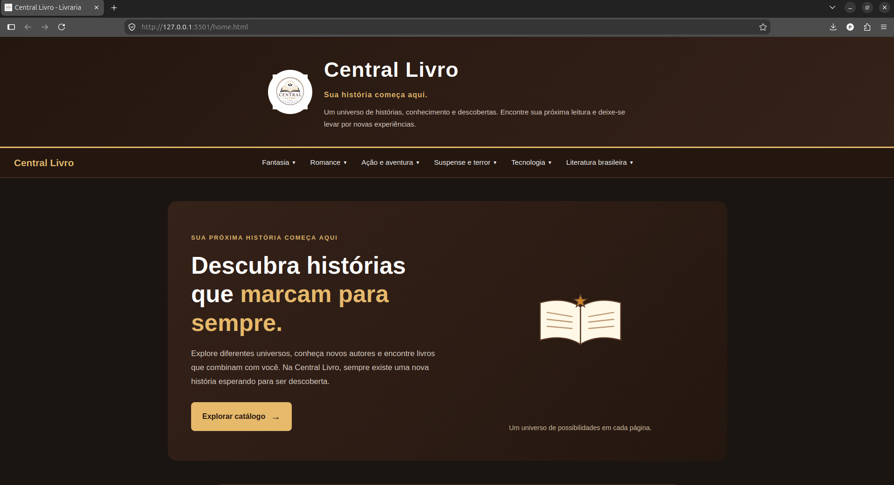
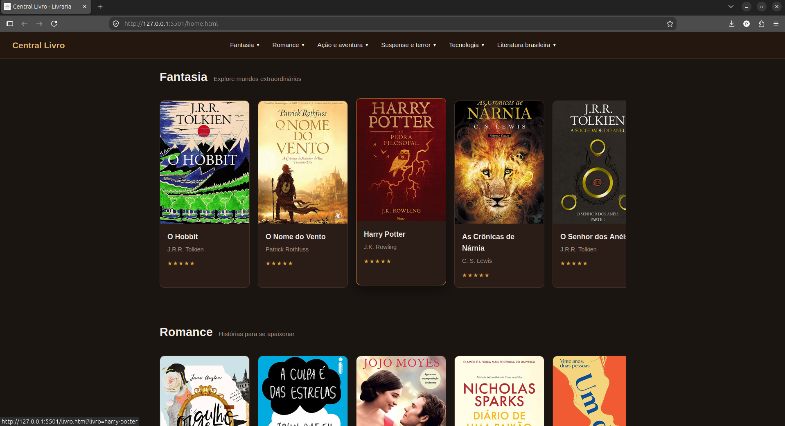

<div align="center">

# 📚 Central Livro
### Sua história começa aqui.

Uma livraria digital desenvolvida como projeto integrador da disciplina de **Desenvolvimento Front-end para Web**. A Central Livro organiza livros por gêneros e busca oferecer uma experiência de navegação prática, acolhedora e responsiva para leitores descobrirem sua próxima leitura.

<!-- Substitua pelo print real da versão desktop -->


</div>

---

## 📖 Sobre o projeto

A **Central Livro** é uma livraria virtual criada para apresentar livros de diferentes gêneros em uma interface organizada. O objetivo é facilitar a descoberta de títulos e autores por meio de um catálogo, pesquisa e acesso à página de detalhes dos livros.

O público é formado por pessoas que gostam de ler e desejam encontrar novas histórias de maneira prática. O projeto prioriza organização visual, navegação intuitiva e adaptação a diferentes tamanhos de tela.

## ✨ Funcionalidades

- Catálogo organizado em Fantasia, Romance, Ação e aventura, Suspense e terror, Tecnologia e Literatura brasileira.
- Pesquisa de livros por título ou autor, com normalização de maiúsculas, minúsculas e acentuação.
- Acesso à página de detalhes a partir dos cards do catálogo.
- Menu de navegação por gêneros.
- Vídeos distribuídos pelo site, com controles e reprodução sem áudio.
- Reprodução dos vídeos quando entram na área visível e pausa quando saem dela.
- Layout responsivo para desktop e dispositivos móveis.
- Recursos de acessibilidade, como textos alternativos, labels e atributos ARIA conforme implementados.

## 🧰 Tecnologias utilizadas

| Tecnologia | Utilização |
|---|---|
| HTML5 | Estrutura semântica e conteúdo |
| CSS3 | Estilização, layouts e responsividade |
| JavaScript puro (Vanilla) | Pesquisa, interações do catálogo e comportamento dos vídeos |
| SVG | Ilustração vetorial relacionada ao tema |
| Git e GitHub | Controle de versão e hospedagem do repositório |

O projeto utiliza HTML, CSS e JavaScript puros, sem frameworks front-end.

## 🖼️ Capturas de tela

Adicione os prints na pasta `assets/images/`. Os caminhos abaixo são espaços reservados para as imagens que serão incluídas.

### Desktop

<!-- TODO: adicionar captura real -->


### Celular

<!-- TODO: adicionar captura real -->


## 📂 Estrutura do projeto

Árvore resumida — ajuste os nomes para refletir exatamente a organização final do repositório.

```text
projeto-front-end/
├── css/
│   ├── style.css
│   └── ... (demais folhas de estilo)
├── img/
│   ├── logo1.ico
│   └── ... (capas dos livros)
├── imagens/
│   └── ... (imagens adicionais, se utilizadas)
├── javaScript/
│   ├── script.js
│   ├── catalog.js
│   └── video.js
├── videos/
│   ├── pilha-de-livros.mp4
│   ├── leitura-compartilhada.mp4
│   └── escolhendo-livros.mp4
├── home.html
├── livro.html
├── login.html
├── cadastro.html
└── README.md
```

> Mantenha os caminhos relativos consistentes com a estrutura real. Atualize esta árvore se os arquivos forem reorganizados.

## 🚀 Como executar

### Abrindo diretamente

1. Clone ou baixe o repositório.
2. Abra a pasta do projeto.
3. Abra `home.html` no navegador.

### Usando o Live Server

1. Abra a pasta do projeto no Visual Studio Code.
2. Instale a extensão **Live Server**, caso necessário.
3. Clique com o botão direito em `home.html`.
4. Selecione **Open with Live Server**.

Para conferir a entrega, teste também a visualização responsiva do DevTools e verifique imagens, vídeos, links, scripts e o console.

## 🧭 Mapa dos requisitos

O documento da disciplina solicita que o README indique em qual arquivo e seção cada requisito foi atendido. Este mapa é uma base de referência: confirme os nomes e acrescente função/trecho ou linha na revisão final.

| Requisito | Arquivo / seção | Conferência |
|---|---|---|
| HTML5, idioma, metadados e título | Páginas HTML — `<head>` | `DOCTYPE`, `lang`, `charset`, `viewport` e `title` |
| Semântica | HTML — `header`, `nav`, `main`, `section`, `footer` | Um `main` por página e estrutura semântica |
| Conteúdo do tema | `home.html` — `#catalogo` | Categorias, livros, imagens e textos alternativos |
| Formulários | `login.html` e `cadastro.html` | Labels, validações e campos obrigatórios |
| Mídia e faixas de texto | `home.html` — `.secao-video`; pasta `videos/` | Fontes, `preload`, `poster` quando aplicável e `<track>` |
| SVG | `home.html` — seção de destaque | Ilustração e descrição acessível |
| CSS e responsividade | Pasta `css/` | Variáveis, componentes, estados e layouts responsivos |
| Pesquisa por título/autor | `javaScript/script.js` | Evento, normalização e atualização dos resultados |
| Detalhes do livro | `javaScript/catalog.js` e `livro.html` | Seleção e apresentação do livro |
| Reprodução/pausa de vídeo por visibilidade | `javaScript/video.js` | Observação de entrada/saída da tela |
| Acessibilidade | HTML, CSS e JavaScript | `alt`, `label`, ARIA, foco e teclado |
| Console e recursos | DevTools — Console e Network | Sem erros JavaScript e respostas 404 |

### Requisitos específicos de JavaScript

A entrega também pede quatro blocos de JavaScript integrados a uma lista de pelo menos cinco objetos, com três ou mais propriedades. **Preencha os detalhes abaixo após confirmar que esses requisitos estão implementados** — não marque como concluído algo que ainda não exista no código.

| Bloco | Arquivo e função/trecho a indicar | Situação |
|---|---|---|
| Lógica: dados, classificação, resumo, condicionais e laços | Arquivo/função: **preencher** | A confirmar |
| Funções, retorno, coerção explícita e escopo local | Arquivo/função: **preencher** | A confirmar |
| `map`, `filter`, `reduce` e criação de elementos com DOM | Arquivo/função: **preencher** | A confirmar |
| Eventos, delegação, busca/filtro e resumo dinâmico | Arquivo/função: **preencher** | A confirmar |
| Botão acessível com `aria-expanded` ou `aria-pressed` | HTML/JavaScript: **preencher** | A confirmar |

> Sempre que possível, substitua “preencher” por nome de função e seção ou linha do arquivo.

## 👤 Autor

- **Nome:** [Seu nome completo]
- **RGM:** [Seu RGM]
- **Curso:** Análise e Desenvolvimento de Sistemas
- **Disciplina:** Desenvolvimento Front-end para Web

## 📌 Observações

Projeto acadêmico desenvolvido para consolidar os conteúdos estudados na disciplina. Antes da entrega, recomenda-se clonar o repositório em uma pasta limpa e verificar se a página abre sem ajustes, se os recursos locais carregam e se o console permanece sem erros.

---

<div align="center">

**Central Livro — Sua história começa aqui.** 📚

</div>